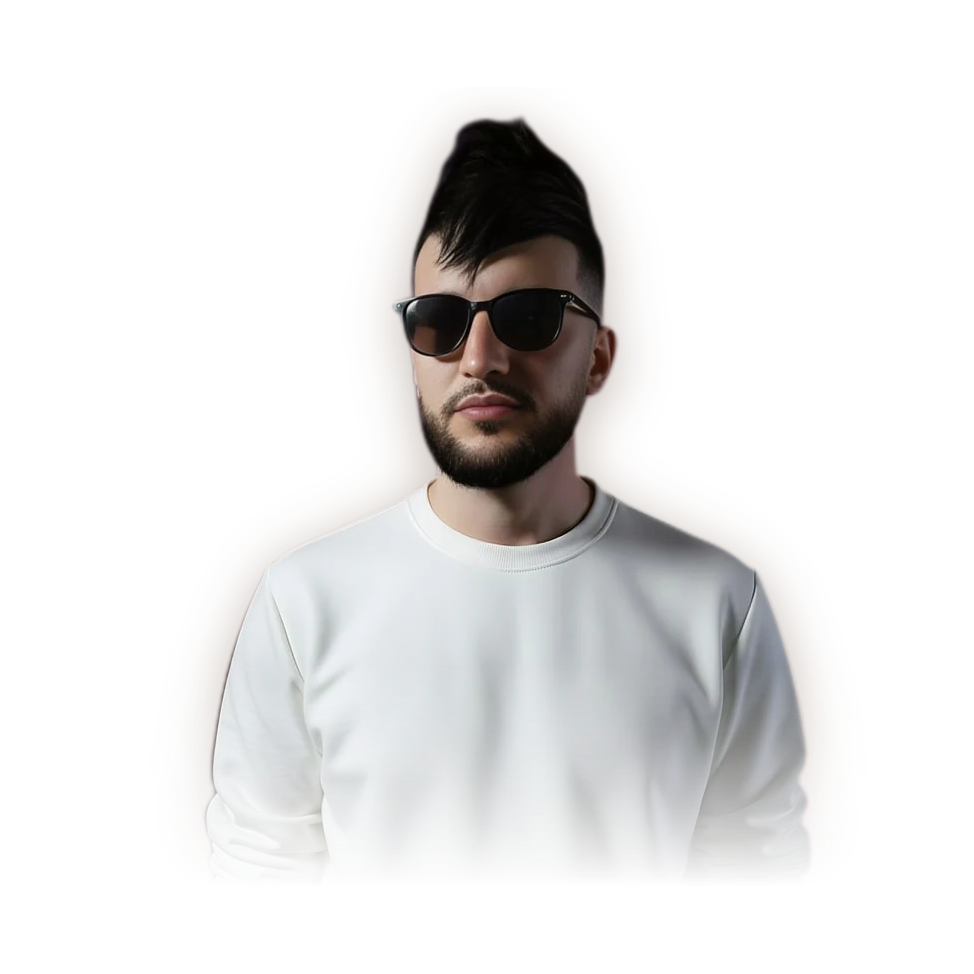

<!-- Header -->

  

  

  
  
  

---

### 👋 About me

I'm **Abderrahmane**, a Full-Stack Developer at the **Port Authority of Algiers (EPAL)**, with a Master's degree in Intelligent Computer Systems from the University of Algiers 1.

I build complete products, **from design to production**: web and mobile apps, payment platforms, video games, Islamic apps and AI solutions such as **EpalGPT** and **EpalCHAT**, used every day by **3,200+ employees**.

- 🌱 **Now:** building the port's internal tools at EPAL (e-payment, budget monitoring, offline AI)
- 🤝 **Open to:** freelance projects, web & mobile apps, AI integrations
- ✨ **Off the keyboard:** gaming, art, photography and football
- ⚡ **Fun fact:** I type at 120 words per minute

 

### 📊 In numbers

<table align="center">
  <tr>
    <td align="center"><h2>60+</h2>projects delivered</td>
    <td align="center"><h2>5</h2>years of experience</td>
    <td align="center"><h2>4</h2>companies</td>
    <td align="center"><h2>3,200+</h2>EpalCHAT users</td>
    <td align="center"><h2>15</h2>mobile apps</td>
    <td align="center"><h2>8</h2>published games</td>
  </tr>
</table>

---

### 💼 Experience

| When | Role | What I did |
|:--|:--|:--|
| **Jul 2025 – today** | **Full-Stack Developer · EPAL** (Port Authority of Algiers) | E-payment with proforma invoices, budget monitoring, ship zone reports, EpalGPT (offline AI assistant) and EpalCHAT (LAN messaging for 3,200+ employees) |
| **Assignment** | **Full-Stack Developer · Lumen Digital** | Rebuilt the booking platform of a 14-clinic network in an international agile team: booking time halved, 30,000+ appointments booked online |
| **Mar 2022 – Jul 2025** | **Web Developer · CTC** | Civil-engineering platforms: technical database, technical assistance, test and sampling management |
| **Sep 2021 – Jan 2022** | **Software Developer · M&M** | ERP modules for a medical practice: patients, consultations, analyses, inventory, treasury |

### 🚀 Highlights

<table>
  <tr>
    <td width="50%" valign="top">
      <b>🤖 EpalGPT</b> 
      Internal AI assistant running <i>offline</i> on a local server, giving agents secure and fast AI access. 
      <code>Laravel</code> <code>Ollama</code> <code>LLaMA 3</code>
    </td>
    <td width="50%" valign="top">
      <b>💬 EpalCHAT</b> 
      Offline instant messaging on the local network, with file sharing, for 3,200+ employees.
    </td>
  </tr>
  <tr>
    <td valign="top">
      <b>💳 E-Payment &amp; Proforma Invoice</b> 
      Online card payment for port clients, with automated and compliant proforma invoices. 
      <code>Laravel</code> <code>Vue / Quasar</code> <code>React</code>
    </td>
    <td valign="top">
      <b>🌾 Sougra</b> 
      Harvest trading between farmers and buyers through reverse auctions: plot mapping, real-time bidding, weather and AI assistant.
    </td>
  </tr>
  <tr>
    <td valign="top">
      <b>🩺 Chrono</b> 
      Web &amp; mobile medical platform for patients, doctors and medical reps: appointments, records, prescriptions, lab results.
    </td>
    <td valign="top">
      <b>🎮 Video games</b> 
      8 published games, including an endless runner in the Algerian desert (10,000+ downloads) and <i>Casbah Quest</i>, a 2D adventure in the Casbah of Algiers.
    </td>
  </tr>
</table>

Healthcare · Retail · Education · Transport · Non-profits · Industry · Tourism · Agriculture

---

### 🛠️ Tech stack

<b>Languages</b>  
  

<b>Frameworks &amp; mobile</b>  
  

<b>Data, DevOps &amp; cloud</b>  
  

<b>AI</b>  
  
  &nbsp;
  
  
  

---

### 🏆 Awards &amp; certifications

| | |
|:--|:--|
| 🥇 **1st prize, Algiers Digital Hackathon** | Inter-wilaya carpooling app, built in 48 hours |
| 🎮 **Finalist, National Video Game Contest** | With *Casbah Quest*, a 2D adventure in the Casbah of Algiers |
| 🎖️ **Special mention, Algiers AI Hackathon** | Natural-language budget tracking assistant |
| ☸️ **Certified Kubernetes Application Developer (CKAD)** · 2024 | Containers, deployments and orchestration |
| ☁️ **Microsoft Azure Fundamentals (AZ-900)** · 2023 | Cloud services, security and cost management |

### 🎓 Education

- **Master's degree in Intelligent Computer Systems**, University of Algiers 1 (2021)
- **Bachelor's degree in Computer Science**, University of Algiers 1 (2018)

---

  📖 <b>Want the full story?</b> My portfolio is a book you can flip through:
  <a href="https://abderrahmanec.vercel.app"><b>abderrahmanec.vercel.app</b></a>

🔒 Most of my work lives in private repositories (company and client projects), which is why it isn't visible here. Happy to walk you through it.

  

